<div align="center">

<a href="#watch-the-film">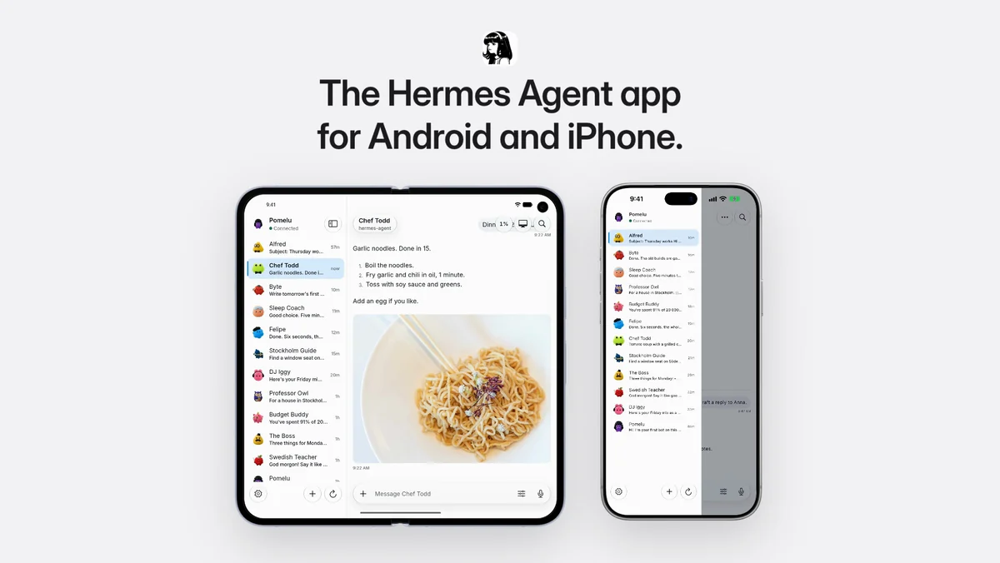</a>

# Pomelu: the Hermes Agent app for Android and iOS

**Open-source mobile client for [Hermes Agent](https://github.com/NousResearch/hermes-agent) by Nous Research.**
Chat with your self-hosted AI agent from your iPhone, iPad, Android phone, foldable or tablet.

<a href="https://apps.apple.com/app/id6826160384"></a>
<a href="https://play.google.com/store/apps/details?id=se.royan.pomelu"></a>

**Pomelu needs a running [Hermes Agent](https://hermes-agent.nousresearch.com/docs/getting-started/installation) 0.21.5 or newer.** Install Hermes Agent before you install the app.

[](https://github.com/ateymoori/pomelu/actions/workflows/ci.yml)
[](https://github.com/ateymoori/pomelu/releases/latest)
[](LICENSE)
[](https://flutter.dev)
[](#get-the-app)
[](#get-the-app)

[Website](https://royan.se/pomelu/) ·
[Watch the film](#watch-the-film) ·
[Features](#features) ·
[Get the app](#get-the-app) ·
[Connect to Hermes](#connect-to-your-hermes-agent) ·
[Build from source](#build-from-source) ·
[FAQ](#faq) ·
[Contribute](CONTRIBUTING.md)

</div>

**Pomelu** is a free, open-source app for
[Hermes Agent](https://hermes-agent.nousresearch.com), the self-hosted AI
agent by Nous Research. Hermes runs on your own Mac, PC, home server or
cloud machine; Pomelu connects to its gateway and puts every Hermes bot in
your pocket. There is no Pomelu account and no tracking. Your chats go between
your phone and your own agent; optional push passes a relay that cannot read
them.

<p align="center">
  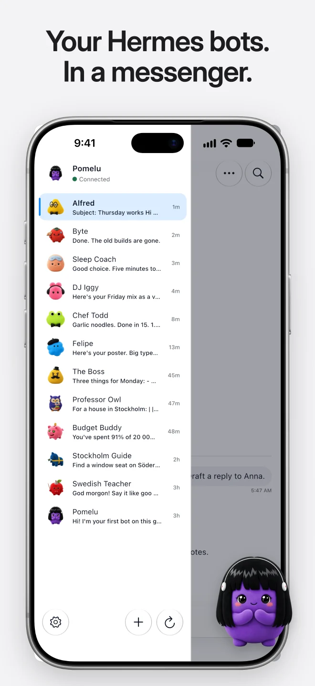
  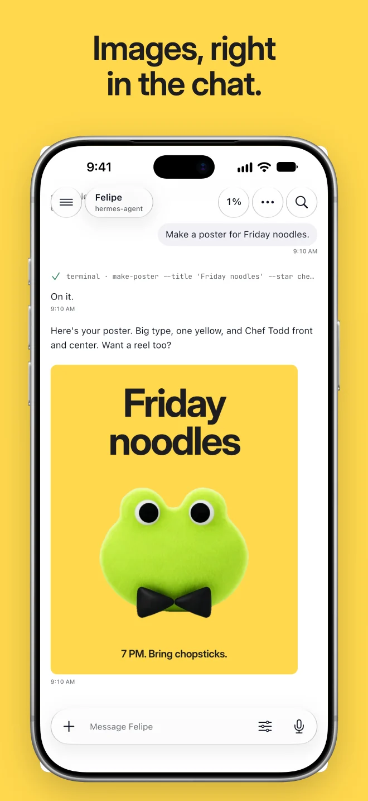
  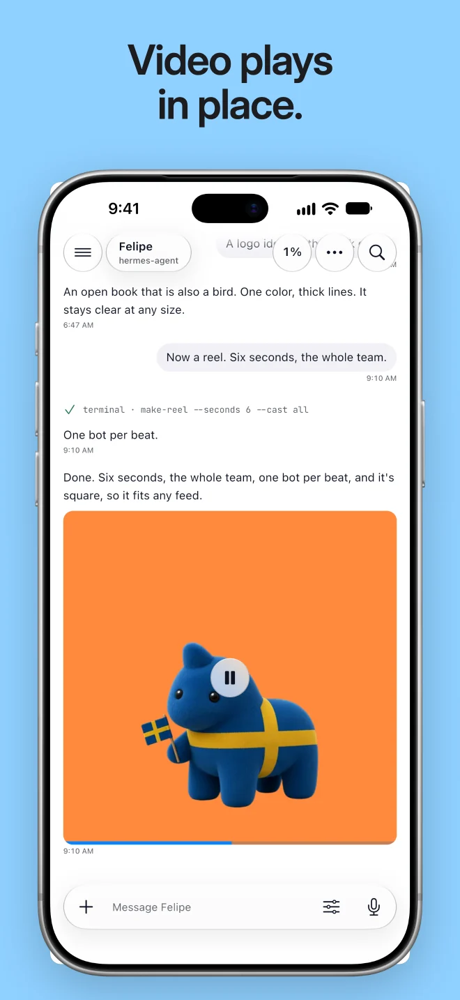
  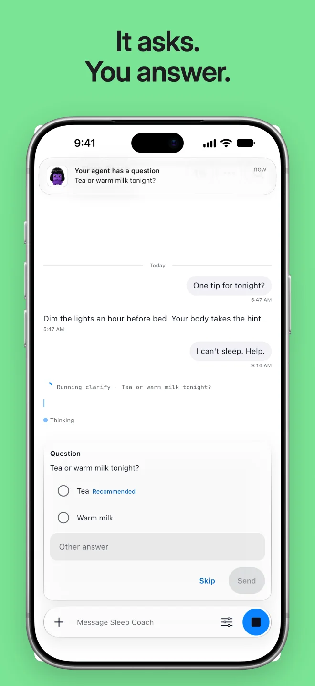
  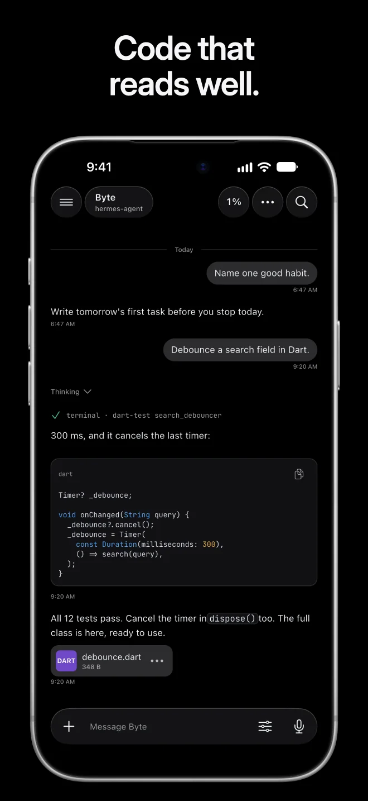
</p>

<p align="center">
  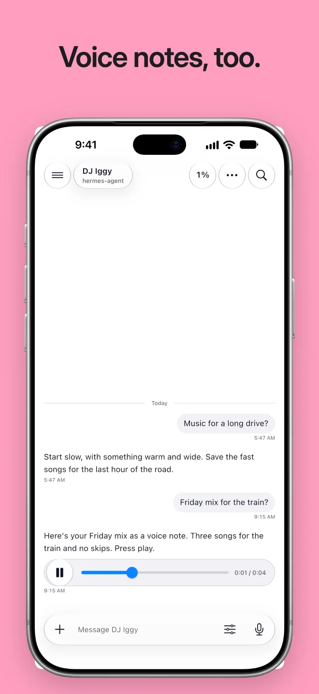
  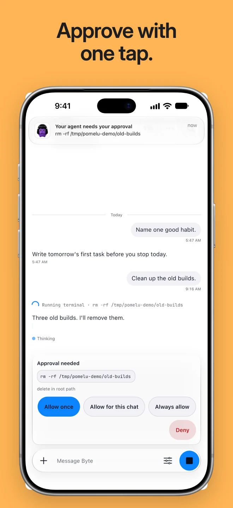
  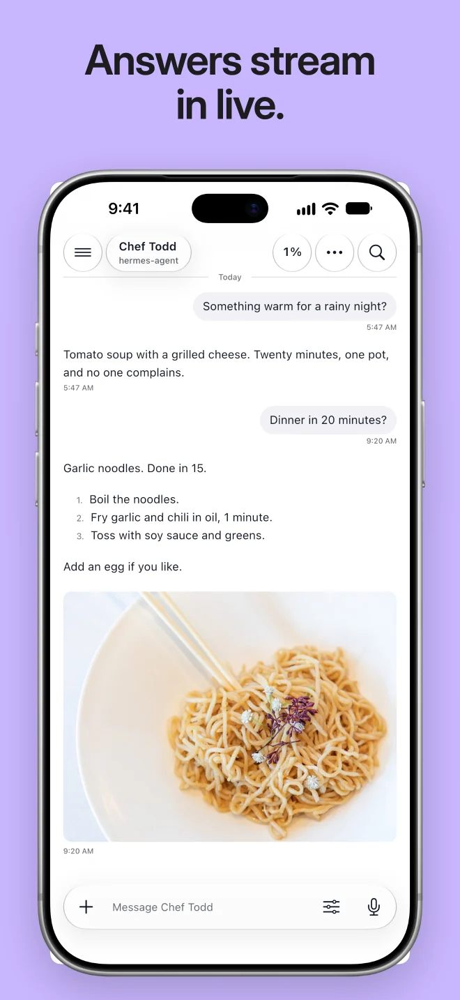
  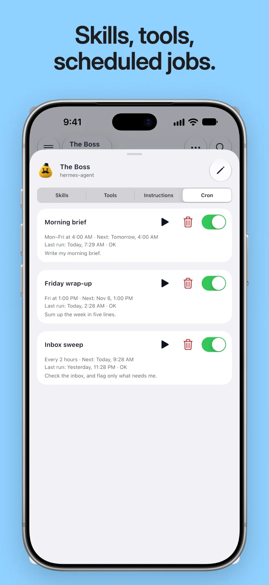
  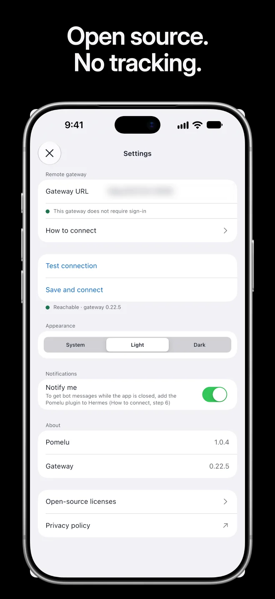
</p>

## Watch the film

https://github.com/user-attachments/assets/3e20ae68-ab06-4e98-803f-13d1bd976505

<details>
<summary><b>Two short vertical cuts</b></summary>

https://github.com/user-attachments/assets/cb499867-c611-4c44-b2fa-ab1b24c80976

https://github.com/user-attachments/assets/26f26178-d87c-4ea2-8e9b-badebdbd9699

</details>

<sub>Real app, real Hermes Agent, demo bots. iPhone Duo 3D model by Pikkme Studio (CC BY 4.0). Music: Dirty Thinkin' (Mixkit).</sub>

## Features

- **One chat per bot**, like a messenger. Every Hermes profile is a bot in
  the side menu; a new conversation starts in the same chat.
- **Live answers** in Markdown with code, tables, tool activity and the
  agent's plan while a task runs. Stop a turn at any time.
- **Answer the agent**: questions, approvals and secret input show up as
  cards in the chat and as notifications.
- **Voice, photos, video and files both ways**, plus a place from a map.
  Replies can be read aloud in the bot's own voice.
- **Share from any app** into a bot. Your bots sit in the share sheet and
  in the app icon's menu.
- **Bot details**: skills, tools, instructions, `SOUL.md` (editable) and
  scheduled cron jobs (pause, resume, run now, delete). Create, rename and
  delete bots like Hermes Desktop.
- **Bot Screen**: watch a bot work on its own Linux desktop, take over with
  touch, keyboard, paste and drag and drop, then hand it back. Needs a Linux
  gateway host with [Bot Screen](https://hermes-agent.nousresearch.com/docs/user-guide/features/bot-screen)
  set up.
- **Notifications** for replies and questions. On Android the app can stay
  connected in the background.
- **Private by design**: no analytics, no ads, no tracking. The sign-in is
  kept in the Android Keystore or the iOS Keychain.
- **Liquid Glass** design (iOS 27 style), light and dark mode, Dynamic
  Type, VoiceOver and TalkBack.

### Made for foldables and tablets

Galaxy Z Fold, Pixel Fold, iPhone Duo, iPad and Android tablets get a side
pane with your bots next to the chat, a reading-width column, hardware
keyboard shortcuts and right-click.

<p align="center">
  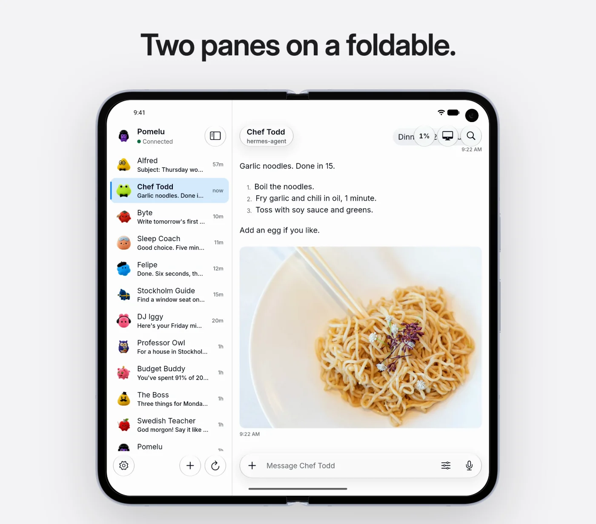
  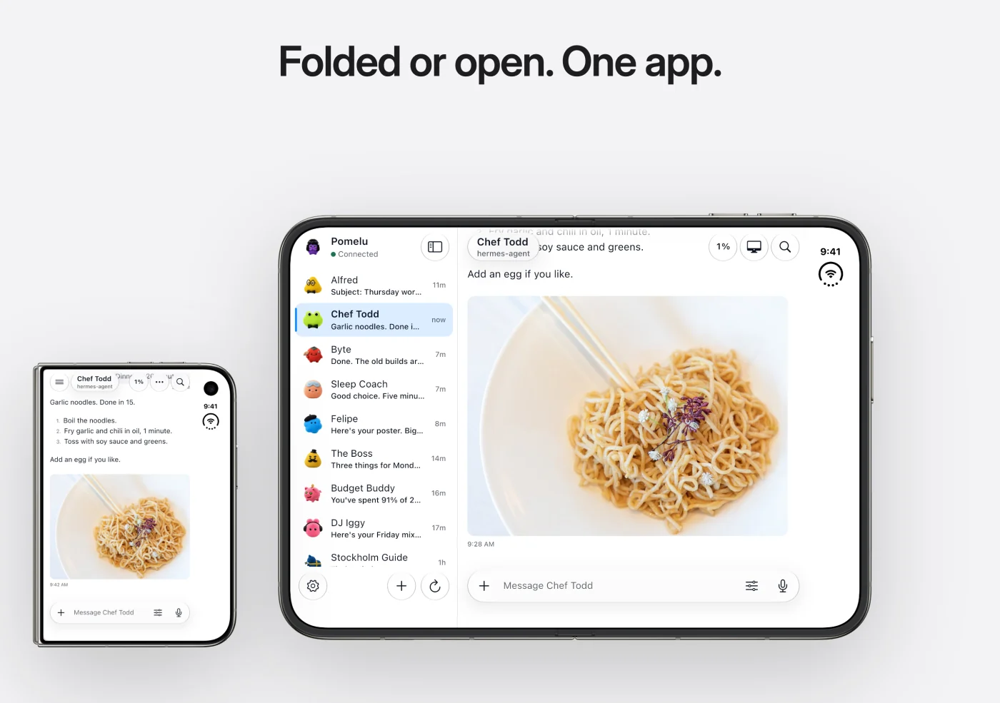
  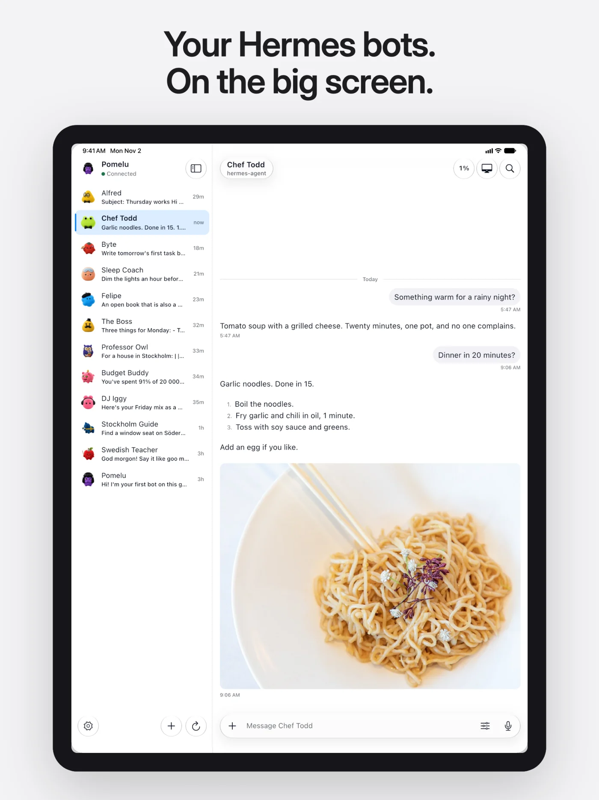
  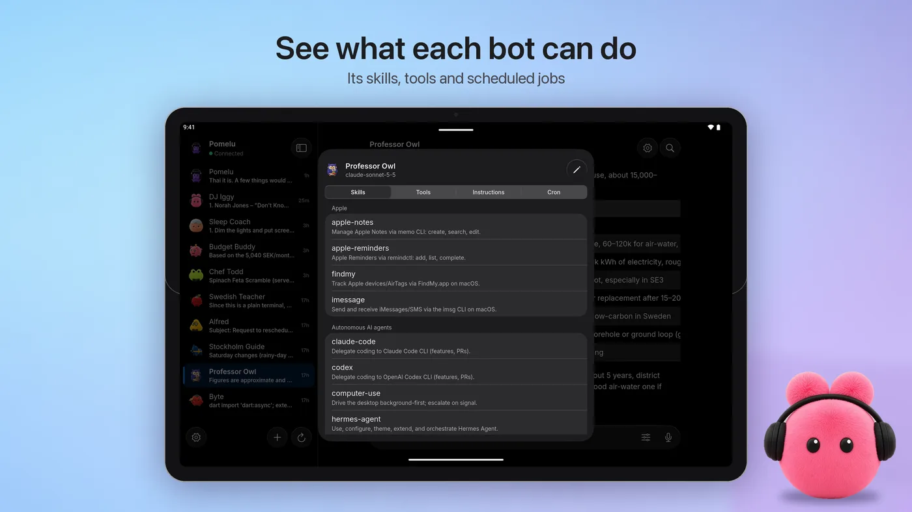
</p>

### Bot Screen

Watch a bot work on its own Linux desktop, live in the app. When it needs you, tap
**Take over**, do your part, and hand it back.

<p align="center">
  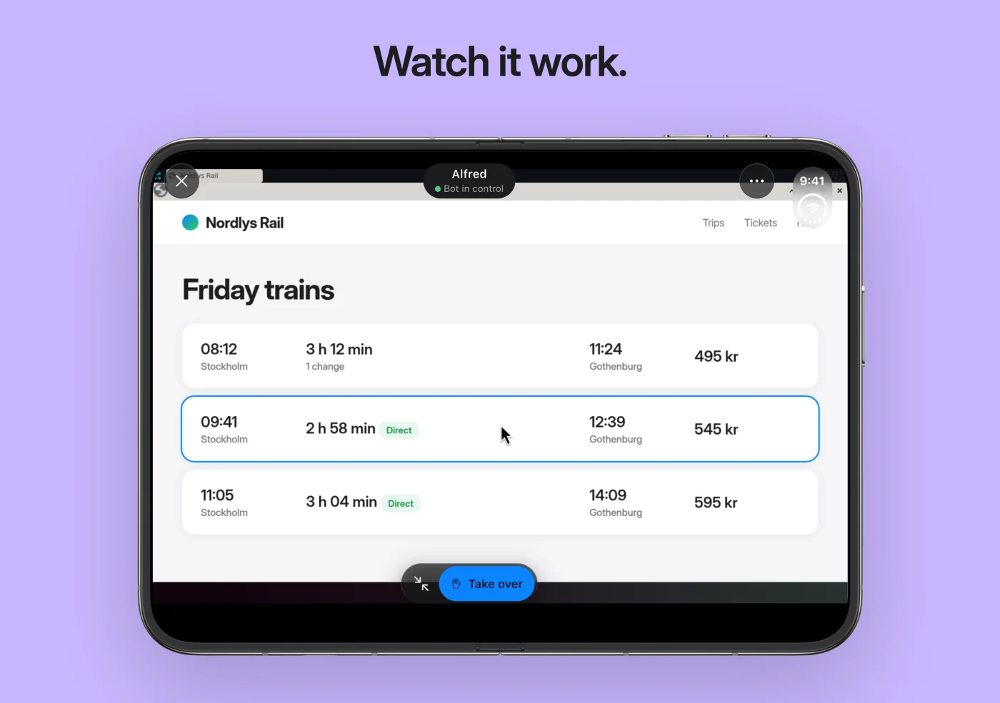
  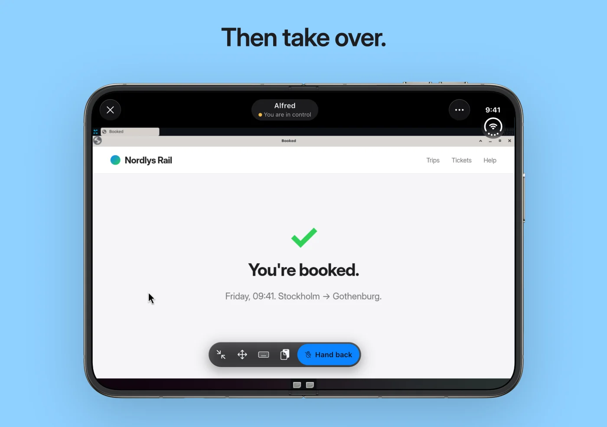
</p>

## Get the app

| Platform | How |
|---|---|
| **Android** 10+ (phones, foldables, tablets) | **[Get it on Google Play](https://play.google.com/store/apps/details?id=se.royan.pomelu)** |
| Android, from GitHub | [Download the signed APK](https://github.com/ateymoori/pomelu/releases/latest) (`arm64-v8a` for most phones, `universal` for the rest; SHA-256 sums on the release page), or [add it to Obtainium](https://apps.obtainium.imranr.dev/redirect?r=obtainium://add/https://github.com/ateymoori/pomelu) to follow the GitHub releases |
| **iPhone and iPad** (iOS 15+) | **[Download on the App Store](https://apps.apple.com/app/id6826160384)** |

The GitHub APK has a different signature from the Google Play build, so
Android will not update one over the other. To switch, uninstall the one you
have and sign in again. More at [royan.se/pomelu](https://royan.se/pomelu/).

## Connect to your Hermes Agent

You need [Hermes Agent](https://hermes-agent.nousresearch.com/docs/getting-started/installation)
0.21.5 or newer on your own computer or server.

1. Set a username and password for the gateway in `~/.hermes/.env` (make
   the secret with `openssl rand -base64 32`):

   ```ini
   HERMES_DASHBOARD_BASIC_AUTH_USERNAME=me
   HERMES_DASHBOARD_BASIC_AUTH_PASSWORD=a-strong-password
   HERMES_DASHBOARD_BASIC_AUTH_SECRET=paste-the-secret-here
   ```

2. Start the gateway and keep it running:

   ```bash
   hermes dashboard --host 0.0.0.0 --no-open
   ```

3. In Pomelu, open **Settings**, enter the address (for example
   `http://192.168.1.20:9119` on the same Wi-Fi), sign in, then tap
   **Test connection** and **Save and connect**.

4. So that your bots can start a conversation, also while the app is closed
   (like on Telegram), use Pomelu 1.0.3 or newer and Hermes 0.22 or newer, and
   install the
   [Pomelu plugin](https://github.com/ateymoori/pomelu-hermes-plugin) on the
   same computer, then restart Hermes:

   ```bash
   hermes plugins install ateymoori/pomelu-hermes-plugin --enable
   hermes pomelu setup
   ```

Away from home, use a private network such as [Tailscale](https://tailscale.com)
or put the gateway behind HTTPS. The same guide is in the app under
Settings → "How to connect".

## Build from source

Requirements: [Flutter](https://docs.flutter.dev/get-started/install) 3.47
(stable), the Android SDK (API 29+), and Xcode for iOS.

```bash
git clone https://github.com/ateymoori/pomelu.git
cd pomelu
flutter pub get
dart run build_runner build -d   # freezed, json, riverpod
flutter gen-l10n
flutter analyze && dart analyze && flutter test
flutter run
```

- **Android:** without `android/key.properties` the release build is
  debug-signed, which is fine for your own phone.
- **iOS:** Swift Package Manager only (no CocoaPods). Set your own team and
  bundle id in Xcode; the share extension needs an App Group with the same
  prefix.

A fork that you publish needs its own name, icon and app id: see
[TRADEMARKS.md](TRADEMARKS.md).

## How it works

Pomelu is a pure client. It speaks JSON-RPC over WebSocket to the Hermes
gateway (`/api/ws`) and uses the dashboard's REST routes for bots, skills and
cron jobs. It has no agent logic of its own.

| Doc | What it covers |
|---|---|
| [Architecture](docs/ARCHITECTURE.md) | Layers, Riverpod providers, the gateway SDK, platform code, chat, sharing, notifications |
| [Protocol](docs/PROTOCOL.md) | The parts of the Hermes gateway protocol that the app uses |
| [Design](docs/DESIGN.md) | Liquid Glass, design tokens, widgets, foldables and tablets, accessibility |
| [Testing](docs/TESTING.md) | Unit, widget and Maestro end-to-end tests, a local backend |

Built with [Flutter](https://flutter.dev), [Riverpod](https://riverpod.dev),
go_router, freezed, dio, gpt_markdown, flutter_map and
[noVNC](https://novnc.com).

## FAQ

**Is Pomelu made by Nous Research?**
No. Pomelu is an unofficial, community-made client by Royan AB. It is not
affiliated with or endorsed by Nous Research.

**Do I need an account or a cloud service?**
No. Pomelu talks to the Hermes Agent gateway that you run; optional push passes
a relay that cannot read it. Royan AB collects no data ([privacy policy](https://royan.se/pomelu/privacy/)).

**Which AI models does it support?**
All the models your Hermes Agent uses (for example Claude, GPT, Gemini,
Llama or a local model). Pomelu shows what the agent sends.

**Can I use it away from home?**
Yes, through a private network such as Tailscale, or with the gateway behind
HTTPS.

**Can my bots start a conversation, like on Telegram?**
Yes, with Pomelu 1.0.3 or newer and the
[Pomelu plugin](https://github.com/ateymoori/pomelu-hermes-plugin) for Hermes: a reminder or a scheduled job made in Pomelu then comes to the
bot's chat, and the phone rings by push, also while the app is closed. The
message is sealed on your Hermes with a key only your phone has; the Pomelu
push relay that hands it to Apple or Google cannot read it.

**Is it free?**
Yes. The app is free, with no ads and no in-app purchases, and the code is
open source under Apache 2.0.

## Contributing

Bug reports and pull requests are welcome. Read
[CONTRIBUTING.md](CONTRIBUTING.md) before you start; new features start as an issue.
Security problems: [SECURITY.md](SECURITY.md).

## License

The code is licensed under the [Apache License 2.0](LICENSE). The name
"Pomelu", the logo, the mascot, the bot characters, the promo films and the
store art are not covered: see [TRADEMARKS.md](TRADEMARKS.md) and [NOTICE](NOTICE).

Made by [Royan AB](https://royan.se) in Sweden ·
[royan.se/pomelu](https://royan.se/pomelu/). "Hermes Agent" and
"Nous Research" belong to Nous Research.

---

<div align="center">

### ⭐ Like Pomelu? Give it a star

If Pomelu is helpful to you, please [star this repo](https://github.com/ateymoori/pomelu).
It is free and it helps other Hermes Agent users find the app.

[](https://github.com/ateymoori/pomelu)

</div>
