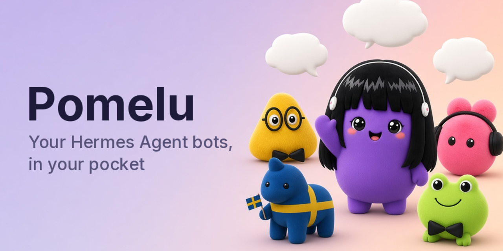
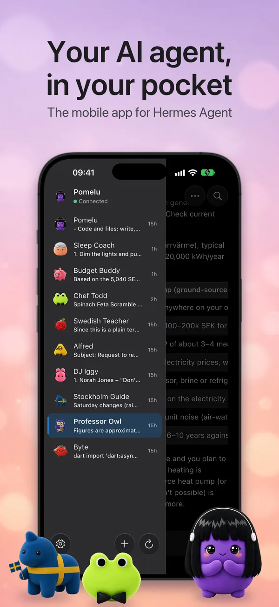
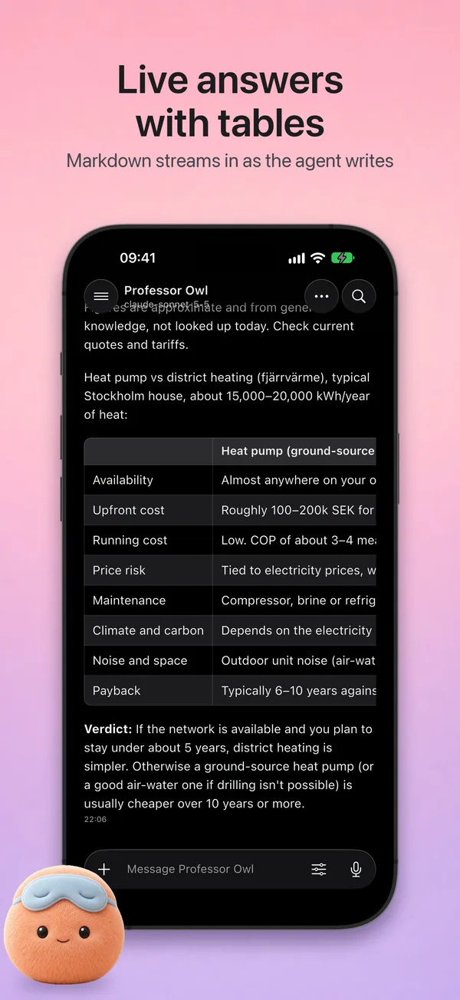
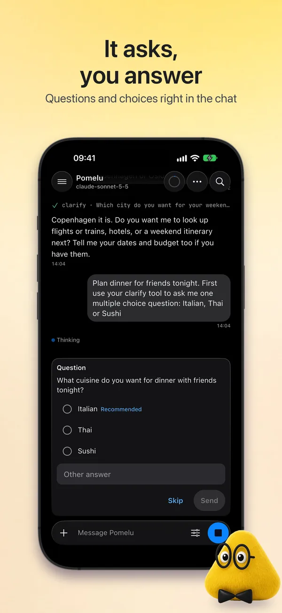
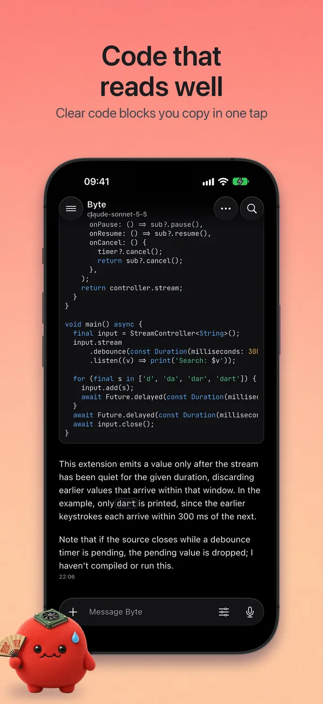
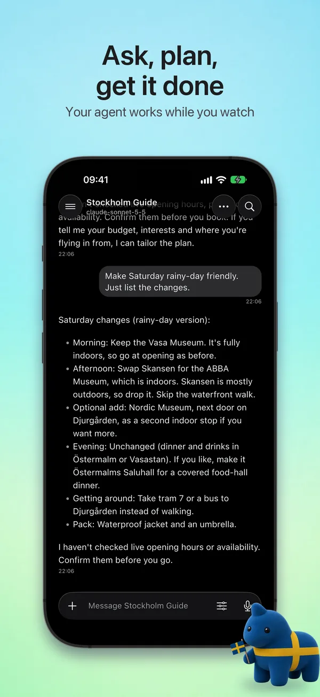
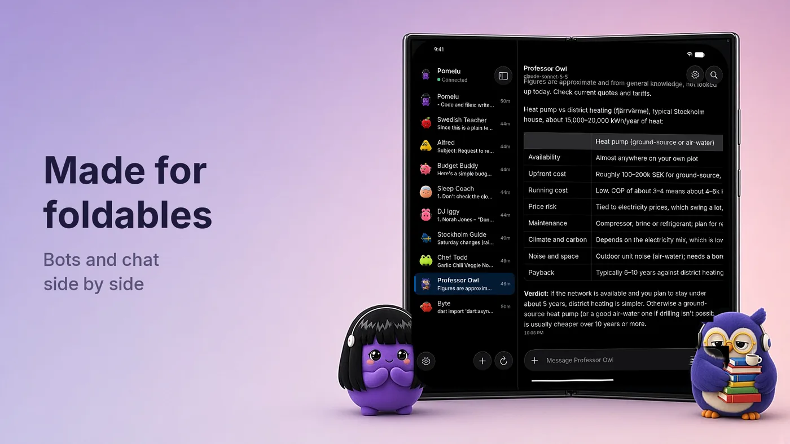
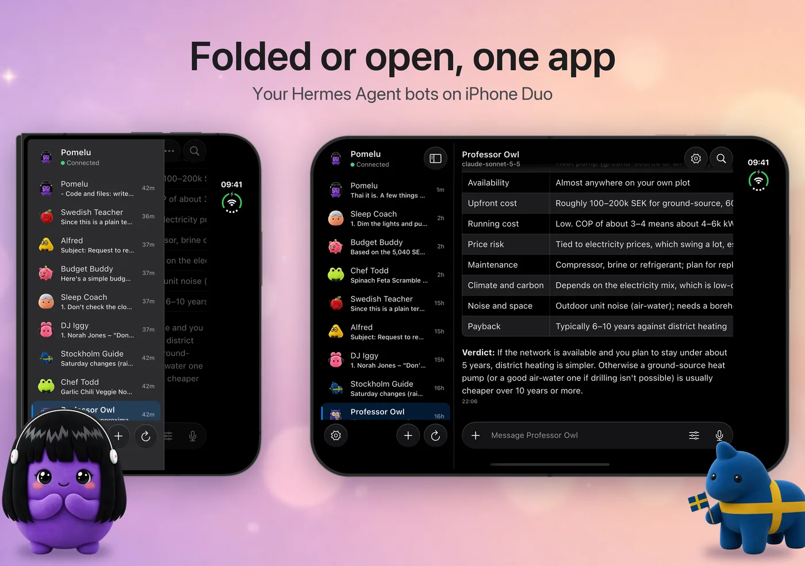
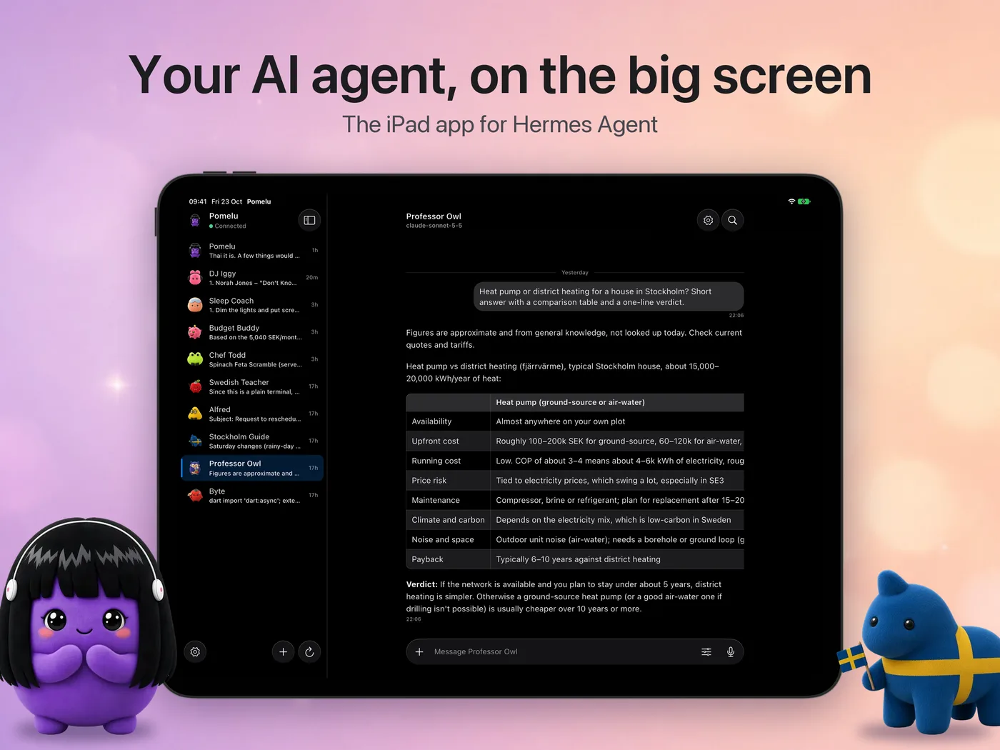
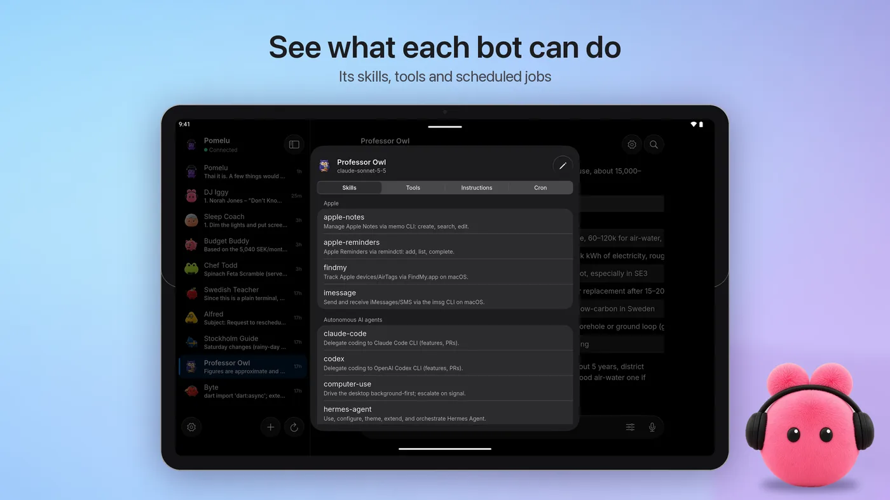

<div align="center">



# Pomelu: the Hermes Agent app for Android and iOS

**Open-source mobile client for [Hermes Agent](https://github.com/NousResearch/hermes-agent) by Nous Research.**
Chat with your self-hosted AI agent from your iPhone, iPad, Android phone, foldable or tablet.

[](https://github.com/ateymoori/pomelu/actions/workflows/ci.yml)
[](https://github.com/ateymoori/pomelu/releases/latest)
[](LICENSE)
[](https://flutter.dev)
[](#get-the-app)
[](#get-the-app)

[Website](https://royan.se/pomelu/) ·
[Features](#features) ·
[Get the app](#get-the-app) ·
[Connect to Hermes](#connect-to-your-hermes-agent) ·
[Build from source](#build-from-source) ·
[FAQ](#faq) ·
[Contribute](CONTRIBUTING.md)

</div>

**Pomelu** is a free, open-source app for
[Hermes Agent](https://hermes-agent.nousresearch.com), the self-hosted AI
agent by Nous Research. Hermes runs on your own Mac, PC, home server or
cloud machine; Pomelu connects to its gateway and puts every Hermes bot in
your pocket. There is no Pomelu server, no account and no tracking: your
chats go only between your phone and your own agent.

**Android beta:** [download the APK](https://github.com/ateymoori/pomelu/releases/latest)
or join the [Google Play beta](#get-the-app). You need your own
[Hermes Agent](https://hermes-agent.nousresearch.com) 0.21.5 or newer.

<p align="center">
  
  
  
  
  
</p>

## Features

- **One chat per bot**, like a messenger. Every Hermes profile is a bot in
  the side menu; a new conversation starts in the same chat.
- **Live answers** in Markdown with code, tables, tool activity and the
  agent's plan while a task runs. Stop a turn at any time.
- **Answer the agent**: questions, approvals and secret input show up as
  cards in the chat and as notifications.
- **Voice, photos, video and files both ways**, plus a place from a map.
  Replies can be read aloud in the bot's own voice.
- **Share from any app** into a bot. Your bots sit in the share sheet and
  in the app icon's menu.
- **Bot details**: skills, tools, instructions, `SOUL.md` (editable) and
  scheduled cron jobs (pause, resume, run now, delete). Create, rename and
  delete bots like Hermes Desktop.
- **Bot Screen**: watch a bot work on its own Linux desktop, take over with
  touch, keyboard, paste and drag and drop, then hand it back. Needs a Linux
  gateway host with [Bot Screen](https://hermes-agent.nousresearch.com/docs/user-guide/features/bot-screen)
  set up.
- **Notifications** for replies and questions. On Android the app can stay
  connected in the background.
- **Private by design**: no analytics, no ads, no tracking. The sign-in is
  kept in the Android Keystore or the iOS Keychain.
- **Liquid Glass** design (iOS 27 style), light and dark mode, Dynamic
  Type, VoiceOver and TalkBack.

### Made for foldables and tablets

Galaxy Z Fold, Pixel Fold, iPhone Duo, iPad and Android tablets get a side
pane with your bots next to the chat, a reading-width column, hardware
keyboard shortcuts and right-click.

<p align="center">
  
  
  
  
</p>

## Get the app

| Platform | How |
|---|---|
| **Android** 10+ (phones, foldables, tablets) | **[Download the APK](https://github.com/ateymoori/pomelu/releases/latest)**: signed; `arm64-v8a` for most phones, `universal` for the rest; SHA-256 sums on the release page |
| Android, with updates | [Add to Obtainium](https://apps.obtainium.imranr.dev/redirect?r=obtainium://add/https://github.com/ateymoori/pomelu): it follows the GitHub releases |
| Android, Google Play beta | Join [the testers group](https://groups.google.com/g/pomelu-testers), then [become a tester](https://play.google.com/apps/testing/se.royan.pomelu) and install from Play |
| **iPhone and iPad** (iOS 15+) | Coming soon to the App Store. Until then, [build it from source](#build-from-source). |

The Play build and the GitHub APK may be signed with different keys: to switch
from one to the other, uninstall first. More at
[royan.se/pomelu](https://royan.se/pomelu/).

## Connect to your Hermes Agent

You need [Hermes Agent](https://hermes-agent.nousresearch.com/docs/getting-started/installation)
0.21.5 or newer on your own computer or server.

1. Set a username and password for the gateway in `~/.hermes/.env` (make
   the secret with `openssl rand -base64 32`):

   ```ini
   HERMES_DASHBOARD_BASIC_AUTH_USERNAME=me
   HERMES_DASHBOARD_BASIC_AUTH_PASSWORD=a-strong-password
   HERMES_DASHBOARD_BASIC_AUTH_SECRET=paste-the-secret-here
   ```

2. Start the gateway and keep it running:

   ```bash
   hermes dashboard --host 0.0.0.0 --no-open
   ```

3. In Pomelu, open **Settings**, enter the address (for example
   `http://192.168.1.20:9119` on the same Wi-Fi), sign in, then tap
   **Test connection** and **Save and connect**.

Away from home, use a private network such as [Tailscale](https://tailscale.com)
or put the gateway behind HTTPS. The same guide is in the app under
Settings → "How to connect".

## Build from source

Requirements: [Flutter](https://docs.flutter.dev/get-started/install) 3.47
(stable), the Android SDK (API 29+), and Xcode for iOS.

```bash
git clone https://github.com/ateymoori/pomelu.git
cd pomelu
flutter pub get
dart run build_runner build -d   # freezed, json, riverpod
flutter gen-l10n
flutter analyze && dart analyze && flutter test
flutter run
```

- **Android:** without `android/key.properties` the release build is
  debug-signed, which is fine for your own phone.
- **iOS:** Swift Package Manager only (no CocoaPods). Set your own team and
  bundle id in Xcode; the share extension needs an App Group with the same
  prefix.

A fork that you publish needs its own name, icon and app id: see
[TRADEMARKS.md](TRADEMARKS.md).

## How it works

Pomelu is a pure client. It speaks JSON-RPC over WebSocket to the Hermes
gateway (`/api/ws`) and uses the dashboard's REST routes for bots, skills and
cron jobs. It has no agent logic of its own.

| Doc | What it covers |
|---|---|
| [Architecture](docs/ARCHITECTURE.md) | Layers, Riverpod providers, the gateway SDK, platform code, chat, sharing, notifications |
| [Protocol](docs/PROTOCOL.md) | The parts of the Hermes gateway protocol that the app uses |
| [Design](docs/DESIGN.md) | Liquid Glass, design tokens, widgets, foldables and tablets, accessibility |
| [Testing](docs/TESTING.md) | Unit, widget and Maestro end-to-end tests, a local backend |

Built with [Flutter](https://flutter.dev), [Riverpod](https://riverpod.dev),
go_router, freezed, dio, gpt_markdown, flutter_map and
[noVNC](https://novnc.com).

## FAQ

**Is Pomelu the official Hermes Agent app?**
No. Pomelu is an unofficial, community-made client by Royan AB. It is not
affiliated with or endorsed by Nous Research.

**Do I need an account or a cloud service?**
No. Pomelu talks only to the Hermes Agent gateway that you run. Royan AB
collects no data ([privacy policy](https://royan.se/pomelu/privacy/)).

**Which AI models does it support?**
All the models your Hermes Agent uses (for example Claude, GPT, Gemini,
Llama or a local model). Pomelu shows what the agent sends.

**Can I use it away from home?**
Yes, through a private network such as Tailscale, or with the gateway behind
HTTPS.

**Is it free?**
Yes. The app is free, with no ads and no in-app purchases, and the code is
open source under Apache 2.0.

## Contributing

Bug reports and pull requests are welcome. Read
[CONTRIBUTING.md](CONTRIBUTING.md) first; new features start as an issue.
Security problems: [SECURITY.md](SECURITY.md).

## License

The code is licensed under the [Apache License 2.0](LICENSE). The name
"Pomelu", the logo, the mascot, the bot characters and the store art are not
covered: see [TRADEMARKS.md](TRADEMARKS.md) and [NOTICE](NOTICE).

Made by [Royan AB](https://royan.se) in Sweden ·
[royan.se/pomelu](https://royan.se/pomelu/). "Hermes Agent" and
"Nous Research" belong to Nous Research.

---

<div align="center">

### ⭐ Like Pomelu? Give it a star

If Pomelu is helpful to you, please [star this repo](https://github.com/ateymoori/pomelu/stargazers).
It is free and it helps other Hermes Agent users find the app.

[](https://github.com/ateymoori/pomelu/stargazers)

</div>
